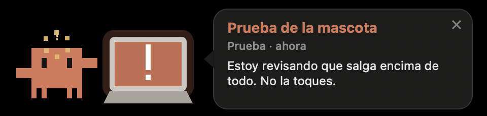

# Mascota de Claude

Un muñeco en pixeles que aparece encima de cualquier ventana de tu Mac cuando una sesión de
**Claude Code** te necesita: te hizo una pregunta, pide permiso o terminó y te toca a ti.



Teclea en su computador, se da cuenta de que te necesita, le sale un "!" en la cabeza, la
pantalla se pone naranja y salta saludándote. Un clic te lleva **a la conversación exacta** que
te está pidiendo algo en la app de Claude.

## Qué hace

- Sale encima de todo, también de apps en pantalla completa y en cualquier escritorio.
- Dice qué te pide y de qué conversación viene, antes de que hagas clic.
- **Clic**: abre esa conversación en la app de Claude. **X**: la cierra. **Arrastrar**: se queda donde la dejes.
- Se esconde sola cuando respondes en esa sesión.
- No molesta si ya estás viendo esa conversación, ni con tareas programadas.
- Varias sesiones esperando: muestra la última y cuántas más hay.

## Requisitos

- macOS 13 o superior, con las herramientas de línea de comandos de Xcode (`xcode-select --install`).
- Claude Code (en terminal o en la app de escritorio de Claude).

## Instalar

```bash
git clone https://github.com/Jacobovillada/mascota-claude.git ~/mascota-claude
~/mascota-claude/scripts/instalar.sh
```

El instalador compila la app en `~/Applications/Mascota Claude.app`, la arranca con el Mac y
conecta los hooks en `~/.claude/settings.json` (deja un respaldo antes de tocarlo). Se puede
correr las veces que quieras sin duplicar nada. Las sesiones que abras desde ese momento ya avisan.

Para verla sin esperar a Claude:

```bash
curl -s -X POST -d '{}' http://127.0.0.1:4956/prueba
```

## Configurar (opcional)

Copia `config.ejemplo.json` a `~/.config/mascota-claude/config.json`:

- `alias`: nombre bonito para cada carpeta de proyecto (`"mi-carpeta": "Mi proyecto"`).
- `sonido`: un sonido del sistema (`Glass`, `Ping`, `Pop`...) o `""` para silencio.
  Respeta el volumen del Mac: en silencio no suena, pero aparece igual.

## Cómo funciona

```
Claude Code ──hook──> scripts/avisar.sh ──HTTP 127.0.0.1:4956──> Mascota Claude.app
```

| Hook | Cuándo | Qué muestra |
|---|---|---|
| `PreToolUse` (AskUserQuestion, ExitPlanMode, recuadro de la app) | te pregunta algo | la pregunta |
| `Notification` | pide permiso o lleva rato esperando | el permiso |
| `Stop` | terminó el turno | lo último que dijo |
| `UserPromptSubmit`, `PostToolUse` | respondiste | se esconde |

Para abrir la conversación exacta usa el enlace `claude://code/continue?session=local_<id>` de
la app de escritorio; el id sale de los archivos que la app guarda en
`~/Library/Application Support/Claude/claude-code-sessions/`. En sesiones de terminal el clic
solo abre la app.

El código está en `Sources/`, un archivo por parte:

| Archivo | Qué tiene |
|---|---|
| `main.swift` | el arranque |
| `Config.swift` | constantes, colores y la configuración |
| `Servidor.swift` | el puerto local que escucha a los hooks (también evita dos copias) |
| `Avisos.swift` | qué hacer con cada aviso |
| `Conversaciones.swift` | lo que se lee de la app de Claude y de las transcripciones |
| `Control.swift` | la ventana: mostrar, esconder y que se vea donde estás |
| `Vista.swift` | el muñeco, su computador y el globo, dibujados en pixeles |
| `Registro.swift` | la bitácora |

## Si no aparece

Todo lo que llega y lo que decide queda en `~/Library/Logs/mascota-claude.log`, con la hora y
el motivo (por ejemplo `no lo muestro: estás viendo esa conversación`). Si la ventana se queda
sin verse, el vigilante la corrige y anota `corrijo en ...` con la causa.

```bash
tail -30 ~/Library/Logs/mascota-claude.log
```

## Desinstalar

```bash
~/mascota-claude/scripts/desinstalar.sh
```

## Licencia

MIT. Proyecto personal, sin relación con Anthropic. Claude es una marca de Anthropic.
